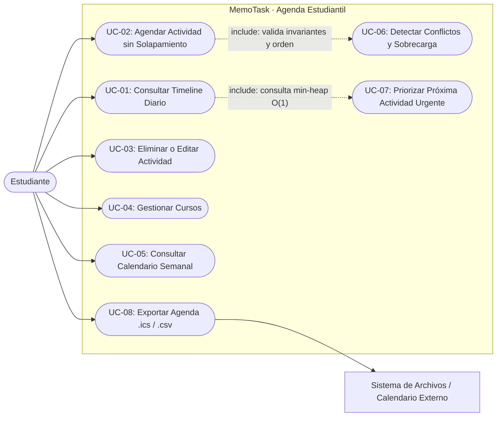
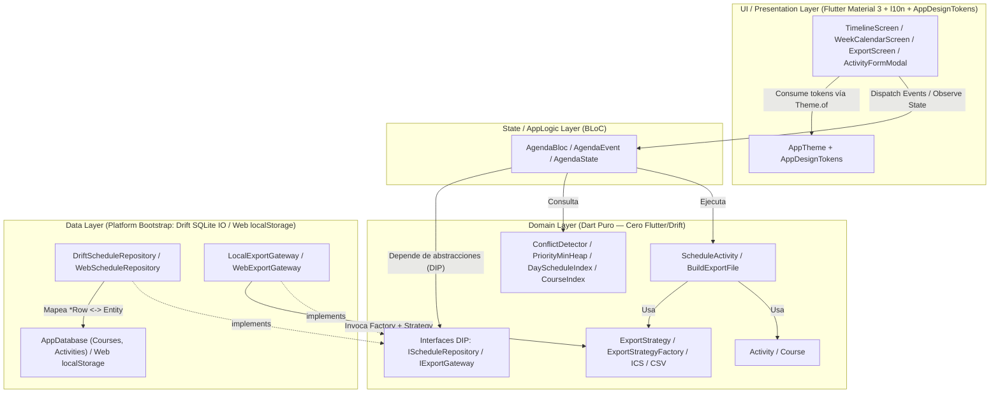
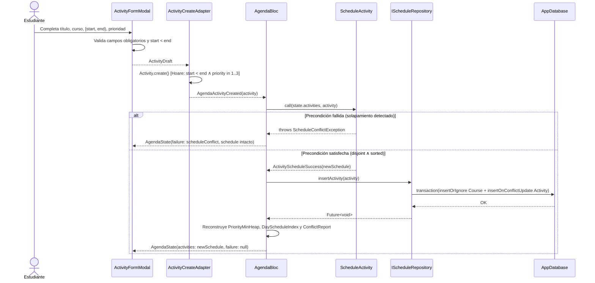
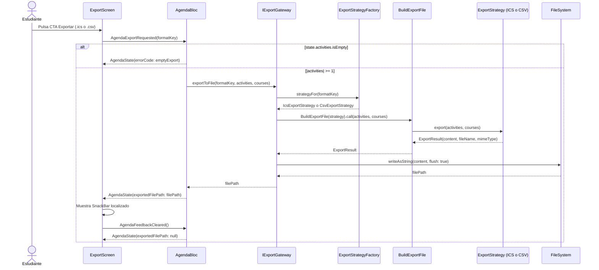
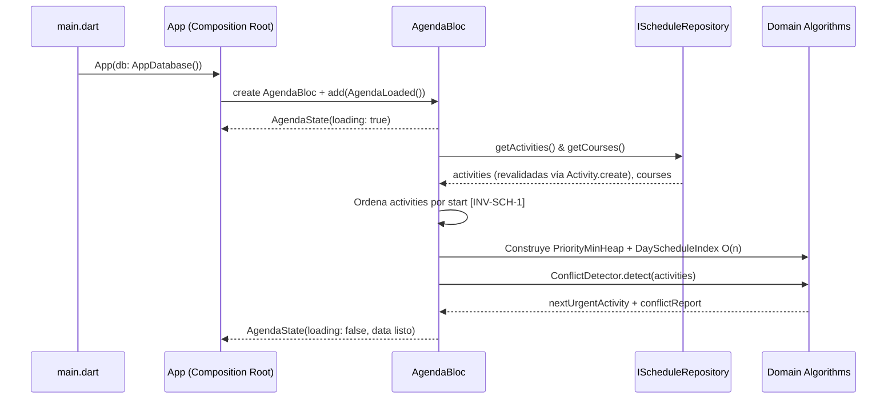
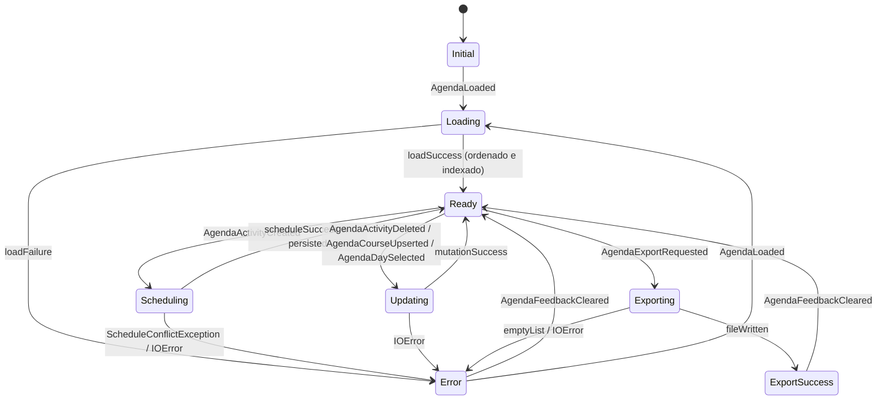
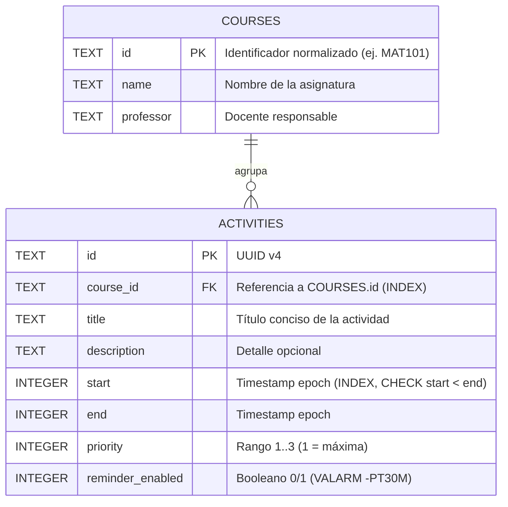
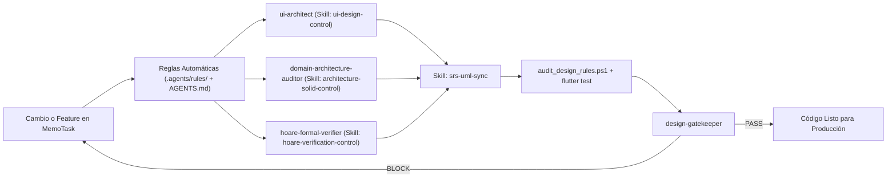

# Arquitectura y Modelado UML — MemoTask

**Propósito:** Proveer la vista estructural, comportamental, de datos y de gobernanza para la arquitectura objetivo SOLID de MemoTask (`UI/Presentation`, `State/AppLogic`, `Domain`, `Data`), trazable al [SRS.md](file:///d:/Documents/SideProjects/MemoTask/docs/SRS.md).

---

## 1. Diagrama de Casos de Uso

---

## 2. Arquitectura en Capas e Inversión de Dependencias (DIP)

---

## 3. Diagrama de Clases Completo (Arquitectura Objetivo SOLID + Patrones)

```mermaid
classDiagram
    direction TB

    class Activity {
        +String id
        +String courseId
        +String title
        +String description
        +DateTime start
        +DateTime end
        +int priority
        +bool reminderEnabled
        -Activity._()
        +create(...) Activity$
        +overlaps(Activity other) bool
        +copyWith(...) Activity
    }

    class Course {
        +String id
        +String name
        +String professor
    }

    class IScheduleRepository {
        <<interface>>
        +getCourses() Future~List~Course~~
        +upsertCourse(Course course) Future~void~
        +getActivities() Future~List~Activity~~
        +insertActivity(Activity activity) Future~void~
        +deleteActivity(String id) Future~void~
    }

    class IExportGateway {
        <<interface>>
        +availableFormats() Set~String~
        +exportToFile(String formatKey, List~Activity~ activities, Map~String, Course~ coursesById) Future~String~
    }

    class ScheduleActivity {
        +call(List~Activity~ schedule, Activity a) ActivityScheduleSuccess
    }

    class BuildExportFile {
        +ExportStrategy strategy
        +call(List~Activity~ activities, Map~String, Course~ coursesById) ExportResult
    }

    class ExportStrategy {
        <<abstract>>
        +String fileExtension
        +String mimeType
        +export(List~Activity~ activities, Map~String, Course~ coursesById) ExportResult
    }

    class IcsExportStrategy {
        +Duration alarmLead
        +export(List~Activity~ activities, Map~String, Course~ coursesById) ExportResult
    }

    class CsvExportStrategy {
        +export(List~Activity~ activities, Map~String, Course~ coursesById) ExportResult
    }

    class ExportStrategyFactory {
        -Map~String, ExportStrategy~ _registry
        +strategyFor(String formatKey) ExportStrategy
        +availableFormats() Set~String~
    }

    class ConflictDetector {
        +detect(List~Activity~ activities) ConflictReport
    }

    class PriorityMinHeap {
        -HeapQueue~Activity~ _heap
        +bool isNotEmpty
        +Activity peekNext
        +add(Activity a) void
        +popNext() Activity
        +drain() List~Activity~
    }

    class DayScheduleIndex {
        -Map~DateTime, List~Activity~~ _byDay
        +normalizeDay(DateTime dt)$ DateTime
        +fromActivities(List~Activity~ activities)$ DayScheduleIndex
        +forDay(DateTime day) List~Activity~
    }

    class CourseIndex {
        -HashMap~String, List~Activity~~ _byCourse
        +add(Activity a) void
        +forCourse(String courseId) List~Activity~
    }

    class DriftScheduleRepository {
        -AppDatabase _db
        +getCourses() Future~List~Course~~
        +upsertCourse(Course course) Future~void~
        +getActivities() Future~List~Activity~~
        +insertActivity(Activity activity) Future~void~
        +deleteActivity(String id) Future~void~
    }

    class LocalExportGateway {
        +ExportStrategyFactory factory
        +exportToFile(...) Future~String~
    }

    class WebScheduleRepository {
        +getCourses() Future~List~Course~~
        +upsertCourse(Course course) Future~void~
        +getActivities() Future~List~Activity~~
        +insertActivity(Activity activity) Future~void~
        +deleteActivity(String id) Future~void~
    }

    class WebExportGateway {
        +ExportStrategyFactory factory
        +exportToFile(...) Future~String~
    }

    class AppDatabase {
        +int schemaVersion
        +Courses courses
        +Activities activities
    }

    class AgendaBloc {
        +IScheduleRepository repository
        +IExportGateway exportGateway
        +ScheduleActivity scheduleActivity
        +ConflictDetector conflictDetector
        +onLoaded()
        +onActivityCreated()
        +onActivityDeleted()
        +onCourseUpserted()
        +onDaySelected()
        +onExportRequested()
        +onFeedbackCleared()
    }

    class AgendaFailure {
        +AgendaErrorCode code
        +String? conflictExistingTitle
        +String? conflictIncomingTitle
    }

    class AgendaState {
        +List~Activity~ activities
        +Map~String, Course~ courses
        +Map~DateTime, List~Activity~~ activitiesByDay
        +DateTime? selectedDay
        +Activity? nextUrgentActivity
        +ConflictReport conflictReport
        +bool loading
        +AgendaFailure? failure
        +String? exportedFilePath
        +visibleActivities() List~Activity~
    }

    class AppDesignTokens {
        +Color brandNavy
        +Color surfaceNavy
        +Color accentLime
        +Color onNavy
        +Color onLime
        +double spaceSm
        +double spaceMd
        +double radiusMd
    }

    IScheduleRepository <|.. DriftScheduleRepository
    IScheduleRepository <|.. WebScheduleRepository
    IExportGateway <|.. LocalExportGateway
    IExportGateway <|.. WebExportGateway
    ExportStrategy <|-- IcsExportStrategy
    ExportStrategy <|-- CsvExportStrategy
    ExportStrategyFactory --> ExportStrategy : creates
    BuildExportFile --> ExportStrategy : uses
    LocalExportGateway --> ExportStrategyFactory : resolves
    LocalExportGateway --> BuildExportFile : executes
    WebExportGateway --> ExportStrategyFactory : resolves
    WebExportGateway --> BuildExportFile : executes
    DriftScheduleRepository --> AppDatabase : persists
    AgendaBloc --> IScheduleRepository : depends on
    AgendaBloc --> IExportGateway : depends on
    AgendaBloc --> ScheduleActivity : executes
    AgendaBloc --> ConflictDetector : analyzes
    AgendaBloc --> PriorityMinHeap : prioritizes
    AgendaBloc --> DayScheduleIndex : indexes by day
    AgendaBloc --> AgendaState : emits
    AgendaState --> AgendaFailure : carries
    ScheduleActivity --> Activity : validates
    AgendaState --> Activity : holds
    AgendaState --> Course : holds
```

---

## 4. Diagrama de Secuencia — Agendar Actividad con Verificación Hoare

---

## 5. Diagrama de Secuencia — Exportación Polimórfica (Factory + Strategy)

---

## 6. Diagrama de Secuencia — Inicialización, Carga e Indexación

---

## 7. Diagrama de Estados — `AgendaBloc`

---

## 8. Diagrama Entidad-Relación — Esquema SQLite / Drift

---

## 9. Flujo de Gobernanza de Diseño (Agentes y Skills)

